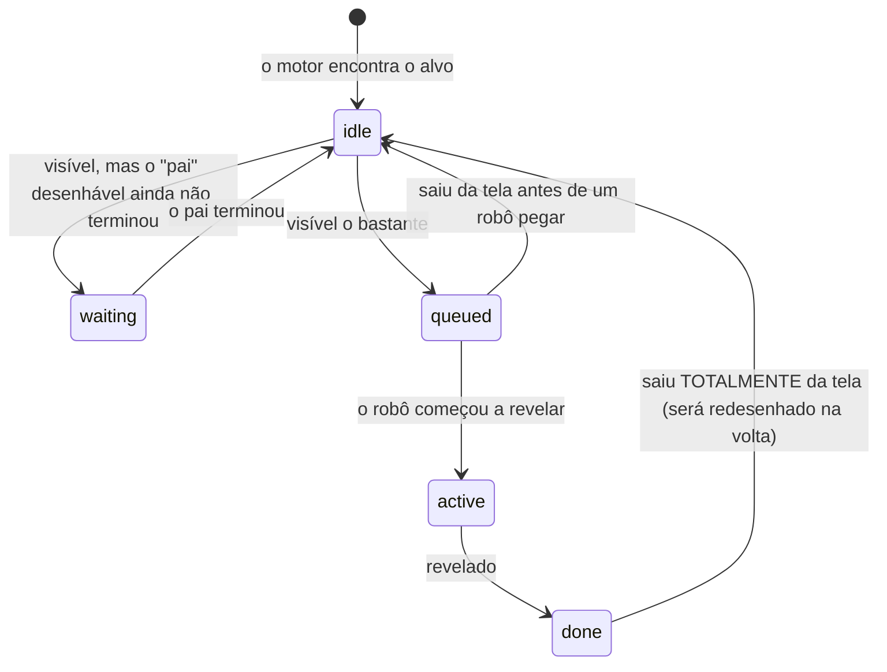

# Motor dos robôs construtores

Os "robôs" são cursores animados que **desenham a página na frente de quem lê**. Eles selecionam um card como num software de ilustração, contornam com a caneta e o revelam, digitam os textos e arrastam os badges quando a lista é embaralhada.

Este documento explica como o motor funciona por dentro: o que cada parte faz, por que foi feita assim e onde mexer para mudar o comportamento.

| Arquivo | Papel |
| --- | --- |
| `drawDirector.ts` | O motor: descobre os alvos, organiza a fila, comanda os robôs e calcula a velocidade |
| `draw.css` | A aparência: o alvo invisível antes do desenho, o cursor, a seleção, as alças, o contorno, a varredura e o cursor de texto |
| `DrawBots.tsx` | Liga o motor quando a página monta (`useEffect(() => startDrawing(), [])`) |

Nada de canvas, nada de biblioteca de animação. Os robôs e tudo o que eles desenham são **elementos HTML comuns**, movidos pela **Web Animations API** (`elemento.animate()`).

---

## 1. Como um componente pede para ser desenhado

O componente não sabe nada sobre robôs. Ele só marca o elemento:

```tsx
<div data-draw="box">…</div>            // seleção + contorno + revelação (o padrão)
<p data-draw="type">…</p>               // o robô clica e digita o texto
<div data-draw="line" />                 // o robô traça a linha com a caneta
<div data-draw="line" data-draw-delay="120" />   // espera mínima antes de começar (ms)
<span data-draw-skip>_</span>            // trecho que a digitação pula (o "_" piscante)
```

Elementos aninhados funcionam: o texto (`type`) dentro de um card (`box`) só começa depois de o card ficar pronto.

O embaralhar dos badges do hero usa a API em vez do atributo (ver o item 5.4).

## 2. Antes do desenho: invisível, mas no lugar

O `draw.css` deixa todo alvo ainda não desenhado assim:

```css
html:not(.dd-off) [data-draw]:not([data-draw-state="active"]):not([data-draw-state="done"]):not(:focus-within) {
  opacity: 0;
  pointer-events: none;
}
```

Foi `opacity`, e não `display: none` nem `visibility: hidden`, de propósito:

- **Sem salto de layout.** O elemento ocupa o espaço final desde o começo, então nada se mexe quando ele aparece. O CLS medido na página é 0.
- **Acessível.** O conteúdo continua lido por leitor de tela e encontrado pelo Ctrl+F, e aparece na hora se receber foco pelo teclado (`:focus-within`).
- **À prova de falha.** Se o motor não ligar (sem JavaScript, `prefers-reduced-motion`, navegador antigo), ele põe a classe `dd-off` no `<html>` e marca tudo como desenhado: a página aparece normal, só sem robôs.

## 3. Estados

O estado de cada alvo fica no atributo `data-draw-state`, e **não em classe**, porque o React reescreve o `className` dos componentes a cada renderização e apagaria uma classe colocada pelo motor.



"Visível o bastante" é ter 10% do elemento na tela, ou 20% da altura da tela no caso de elementos altos (um card enorme nunca chegaria a 10%).

## 4. Como os alvos são descobertos

- **Um único `IntersectionObserver`** vigia todos os alvos e avisa quando entram ou saem da tela.
- **Um `MutationObserver`** pega o que monta depois: os cards do "ver mais", os balões da Experiência, o modal de um case. Tudo o que tem `data-draw` e aparece no DOM entra na hora.
- **As barras deslizantes do "Sobre mim" (`data-slide`) ficam fora do observer.** Elas começam fora da tela pela lateral, e o `overflow-x: clip` da seção zera a interseção. São conferidas pela posição vertical, num `requestAnimationFrame` disparado pela rolagem.

### A regra da saída, e por que ela é geométrica

O alvo só volta a `idle` quando sai **totalmente** da tela, e isso é medido pela caixa real (`getBoundingClientRect`), não pelo observer. Motivo: o observer leva em conta o `clip-path` da animação em curso. Com o elemento metade dentro, metade fora, o recorte da revelação escondia a parte visível, o observer dizia "saiu", o motor reiniciava o elemento e começava tudo de novo, num laço infinito.

## 5. A fila e os robôs

### 5.1 O pool

- **Quantos:** no máximo 8 no desktop, 5 no tablet (menos de 1024 px) e 3 no celular (menos de 640 px).
- **Identidade:** cada robô tem nome e cor próprios (`rpa.bot`, `n8n.flow`, `py.worker`, `llm.agent`…).
- **Quando nascem:** sob demanda. Nasce um robô novo quando não há nenhum livre, ou quando o livre mais perto está a mais de 1,1 tela de distância, e ainda cabe no teto. Ele entra pela borda mais próxima da tarefa.
- **Quando somem:** terminada a tarefa, o robô "solta o mouse", dá um passinho para o lado e some devagar depois de 1,6 s sem trabalho.

### 5.2 A distribuição (`pump`)

1. **Ordem:** a fila é ordenada em ordem de leitura, de cima para baixo e, na mesma linha, da esquerda para a direita.
2. **Quem pega:** cada tarefa vai para o robô livre **mais perto** dela.
3. **Espaçamento:** dois robôs não começam no mesmo instante. Há um intervalo de 90 ms entre largadas, dividido pela velocidade atual.
4. **Sem robô livre:** a tarefa espera, e o próximo robô que terminar chama a distribuição de novo.

### 5.3 O robô por dentro

Cada robô é uma `<div class="dd-bot">` dentro de uma camada transparente por cima da página (`.dd-layer`), com:

- três ícones em SVG embutido (seta, caneta e cursor de texto). O CSS mostra só o da ferramenta atual, lida de `data-tool`;
- a etiqueta com o nome (`.dd-tag`);
- o anel que expande no clique (`.dd-click`).

A camada usa **coordenadas da página**, então os robôs rolam junto com o conteúdo.

O movimento é JavaScript, via `elemento.animate()` com quadros de `translate3d`:

- **`moveTo`**: vai de um ponto a outro passando por um ponto do meio deslocado para o lado, o que dá uma leve curva, como mão de gente. Os robôs pares e ímpares curvam para lados opostos.
- **`path`**: percorre uma sequência de pontos (o contorno do retângulo), com o tempo de cada trecho proporcional ao tamanho dele.
- **`press`**: o "clique", com o ícone encolhendo e um anel que expande.

Por que Web Animations API e não animação CSS:

1. **Destino:** só se sabe para onde ir em tempo de execução, depois de medir o elemento.
2. **Encadeamento:** cada animação devolve uma promessa (`animation.finished`), e é isso que permite encadear andar, apertar, arrastar, contornar e revelar.
3. **Velocidade em curso:** dá para mudar a velocidade de uma animação no meio (`updatePlaybackRate`). A aceleração pela rolagem depende disso.
4. **Cancelamento:** dá para cancelar se o elemento sai da tela no meio do desenho.

Como só muda `transform`, o navegador move o robô sem recalcular o layout da página.

### 5.4 Os quatro jeitos de desenhar

**Caixa (`drawBox`), o padrão:**
1. **Ir ao canto:** o robô vai até o canto superior esquerdo do elemento.
2. **Arrastar a seleção:** aperta o botão e arrasta uma seleção tracejada até o canto oposto, com a medida `W × H` crescendo ao vivo.
3. **Contornar:** solta, aparecem as 8 alças de redimensionar, e a caneta contorna o retângulo. O contorno é um `<rect>` SVG cuja borda é revelada animando o `stroke-dashoffset`.
4. **Revelar:** o conteúdo aparece de cima para baixo, com um recorte (`clip-path: inset`) que abre e uma linha de varredura descendo junto.
5. **Limpar:** a seleção some com fade.

**Digitação (`drawType`):**
1. **Medição:** antes de começar, mede onde cai cada caractere na tela (com `Range.getClientRects`), pulando o que estiver em `data-draw-skip`.
2. **Clique:** o robô vira cursor de texto e clica no início do texto.
3. **Revelação em escada:** o texto real é revelado por um recorte em "escada": as linhas de cima inteiras e a linha atual até a letra da vez. **Nenhuma letra é inserida, removida ou movida no DOM**, por isso o texto não pula e a quebra de linha já é a final.
4. **Ritmo:** cerca de 62 ms por letra em textos curtos, 30 ms nos médios e um total de no máximo ~1,5 s nos longos. Cada letra varia aleatoriamente e a pontuação demora 2,2 vezes mais.
5. **Cursor:** um cursor de texto (`.dd-caret`) acompanha e pisca um pouco no fim.

**Linha (`drawLine`):** a caneta percorre o eixo mais longo enquanto a linha se revela atrás dela. É usada nas três faixas sob cada título de seção.

**Transporte (`drawCarry`), via API:** é o embaralhar dos badges do hero. O componente usa a técnica FLIP:
1. **Fotografar:** guarda onde cada badge estava antes de reordenar.
2. **Reordenar:** deixa o React reordenar a lista.
3. **Chamar o motor:** no `useLayoutEffect`, chama `getDirector().carry(el, posiçãoAntiga)` para cada badge.
4. **Arrastar:** o motor devolve o badge para a posição antiga (`transform`) e um robô o "agarra" e arrasta até a nova. A promessa só resolve no fim, então o componente sabe quando pode embaralhar de novo.

### 5.5 Remontagem

Quando um alvo desenhado sai totalmente da tela, volta a `idle`. Na volta, é desenhado de novo. É assim que o hero se remonta quando você sobe de volta ao topo. Um alvo que termina de ser desenhado já fora da tela também volta direto a `idle`.

## 6. A velocidade

Toda a velocidade passa por uma variável do módulo, `RATE` (1 = normal):

- **animações:** toda animação criada pelo motor passa pela função `anim()`, que aplica `RATE` como `playbackRate` e a acompanha até terminar. Quando `RATE` muda, as animações em curso são ajustadas com `updatePlaybackRate`;
- **pausas:** o `sleep()` divide a espera por `RATE`;
- **digitação:** roda num relógio próprio, que anda `RATE` vezes mais rápido;
- **espaçamento entre largadas:** também é dividido por `RATE`.

### 6.1 A conta (`measureRush` e `updateRate`)

| Ingrediente | Regra |
| --- | --- |
| Velocidade da tela | Média do deslocamento (px/s) nos últimos ~250 ms. Um evento isolado depois de muito tempo conta como salto. Sem rolagem, cai sozinha (~400 ms). |
| Pela rolagem | 1x até 600 px/s (ritmo de leitura), sobe em linha reta até **4x em 3.000 px/s** |
| Pela fila | Só se acumularem mais de duas "rodadas" de robôs esperando: `fila ÷ (2 × robôs)`, até 3x |
| Salto | A tela anda mais de 3/4 da altura de uma vez (menu, link), ou a média passa de 3.000 px/s: **6x** até terminar o que está na tela (mínimo 0,4 s, máximo 3 s). Voltar a rolar devagar encerra o salto. |
| Resultado | O maior dos três. Acelera na hora e desacelera aos poucos (~350 ms). |

Além disso, nos primeiros 2,5 s da página (a abertura do hero) as durações base são 0,6 das normais.

### 6.2 Números medidos (1440 × 900)

| Situação | Velocidade dos robôs |
| --- | --- |
| Rolagem de 300 px/s | 1x |
| Rolagem de 1.200 px/s | 1,6x em média |
| Rolagem de 2.500 px/s | 2,8x em média |
| Salto para Projetos (21 elementos) | tela cheia em 1,5 s (3,0 s sem aceleração) |

## 7. Onde mexer

| Quero… | Onde |
| --- | --- |
| Mais tempo para apreciar ao rolar | `updateRate`: o `600` de `(this.vel - 600) / 800` (abaixo dele, 1x) |
| Saltos ainda mais rápidos | `updateRate`: o `6` de `surge ? 6 : …` |
| Mais ou menos robôs | construtor: `this.maxBots = … ? 3 : … ? 5 : 8` |
| Ritmo da digitação | `drawType`: a linha `const per = n < 30 ? 62 : n < 90 ? 30 : …` |
| Durações da caixa | `drawBox`: os `clamp(…)` de cada etapa (ida, arrasto, contorno, revelação) |
| Aparência do robô, da seleção e das alças | `draw.css` |
| Novo tipo de desenho | um `drawX` novo, um valor novo em `Mode` e o despacho em `run()` |

## 8. Depuração

Em desenvolvimento, o motor fica em `window.__drawDirector`:

```js
__drawDirector.rate                  // velocidade atual (1 = normal)
__drawDirector.queue.length          // tarefas esperando robô
__drawDirector.bots.map(b => b.busy) // quem está trabalhando
```

E o estado de qualquer elemento está no próprio DOM: `el.getAttribute("data-draw-state")`.

⚠️ Com a aba ou a janela do navegador em segundo plano, o navegador pausa o `requestAnimationFrame` e o observer. Os robôs param e os elementos ficam esperando. Isso não é defeito do motor: ao voltar para a aba, tudo continua.

## 9. Lições já pagas

- **Observer e `clip-path` não combinam para decidir a saída.** Ver o item 4: o laço infinito do elemento metade dentro, metade fora.
- **`overflow-x: clip` zera a interseção** de quem começa deslocado na horizontal. Daí as barras do "Sobre mim" usarem checagem própria.
- **Estado em atributo, não em classe**, porque o React reescreve o `className`.
- **Aceleração tem de ter uma fonte só.** Dois aceleradores somando (fila mais rolagem) deixaram a rolagem lenta rápida demais.
- **Média, não pico.** Pela velocidade de um único evento de rolagem, um toque na roda do mouse já acelerava.
- **Ajuste fino precisa de passo fino.** Ignorar mudanças pequenas de velocidade fazia a desaceleração gradual nunca chegar de volta a 1x.
